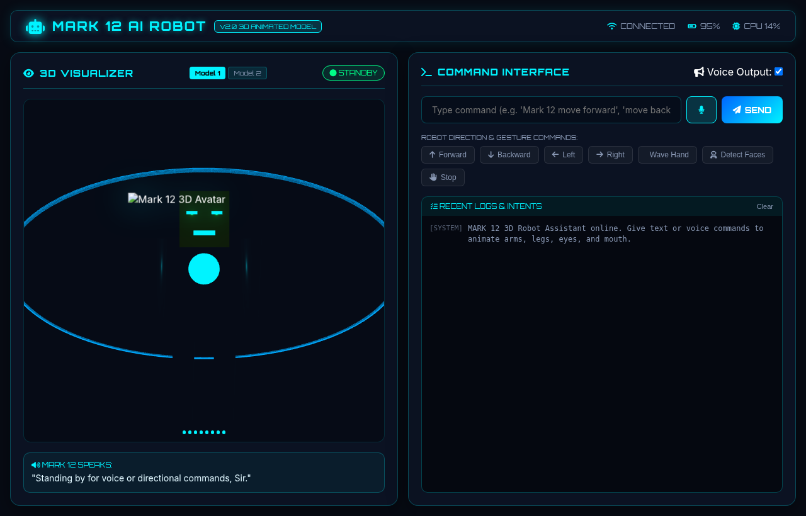

# MARK 12 — AI Voice Assistant Robot 🤖⚡


An industry-grade, modular **AI Voice Assistant Robot** system built with **Ubuntu, ROS2, Python, C++, Java**, and an interactive **Three.js 3D WebGL Avatar Dashboard**. Features real-time speech recognition, spoken speech synthesis, audio-reactive mouth/eye lighting ("Tom Method"), joint-articulated leg and arm animations for directional movement, and ROS2 integration.

---

## 🖼️ System Screenshots & Assets

### 🌐 Live 3D Web Dashboard UI


| MARK 12 Model 1 (Torso 3D Suit) | MARK 12 Model 2 (Full Body Suit) | MARK 12 Holographic Arc Core |
| :---: | :---: | :---: |
|  |  |  |

---

## ✨ Key Features

1. **3D Interactive Articulated Model**:
   - Built with Three.js WebGL and custom canvas texture mapping.
   - **Tom Method Speech Lighting**: Dual cyan Eye LED lens spotlights and audio-reactive Mouth Arc Visor that pulse synchronously during speech playback.
   - **Joint Pivot Animations**: Dedicated leg walking cycles, body bobs, turning pivots, and right arm waving gestures.

2. **Directional Movement & Gesture Execution**:
   - `move_forward` / `Forward ⬆️`: Alternating leg walking swing cycle and forward movement.
   - `move_backward` / `Backward ⬇️`: Reverse leg walking swing cycle.
   - `turn_left` / `Left ⬅️`: 90° body pivot rotation and arm lean left.
   - `turn_right` / `Right ➡️`: 90° body pivot rotation and arm lean right.
   - `wave_hand` / `Wave Hand 👋`: Right arm raises 180° and waves back and forth.
   - `stop` / `Stop 🛑`: Immediate motor halt and return to neutral stance.

3. **Natural Language Processing & Persistent Memory**:
   - Python AI Engine (`intent_classifier.py`, `command_parser.py`, `chatbot.py`).
   - SQLite persistent storage (`robot.db`) logging all past interactions.

4. **Multi-Platform Interfaces**:
   - **Web Dashboard**: 3D Three.js canvas, Web Speech API (STT/TTS), real-time HUD visualizer.
   - **Java Swing GUI**: Multi-window camera feed, telemetry monitor, and manual teleoperation keys.
   - **ROS2 Packages**: Custom ROS2 interfaces (`VoiceText`, `RobotStatus`, `Battery`), `voice_node`, `camera_node`, and `move_robot` C++ nodes.

---

## 📁 System Architecture & Directory Tree

```
AI_Voice_Assistant_Robot/
├── ai_engine/
│   ├── main.py                  # CLI orchestrator loop
│   ├── server.py                # Flask REST API server (serves web_dashboard)
│   ├── chatbot.py               # MARK 12 conversational response generator
│   ├── command_parser.py        # Natural language directional command parser
│   ├── intent_classifier.py     # Intent categorization engine
│   ├── memory.py                # SQLite conversation memory manager
│   ├── speech_to_text.py        # Speech Recognition / Whisper pipeline
│   ├── text_to_speech.py        # pyttsx3 speech synthesizer
│   └── wake_word.py             # Passive listening wake word trigger
│
├── web_dashboard/               # 3D Interactive Web Dashboard
│   ├── index.html               # HUD layout & 3D WebGL canvas
│   ├── style.css                # Sci-Fi blueprint glassmorphism styling
│   └── app.js                   # Three.js 3D MARK 12 model & animation engine
│
├── image/                       # Custom Robot Images & Backgrounds
│   ├── images.jpeg              # MARK 12 Model 1 image
│   ├── images_1.jpeg            # MARK 12 Model 2 image
│   └── background.jpg           # Technical Blueprint HUD background
│
├── ros2_ws/                     # ROS2 Workspace
│   └── src/
│       ├── robot_msgs/          # Custom msg definitions (VoiceText, RobotStatus, Battery)
│       ├── voice_pkg/           # ROS2 speech synthesis and recognition nodes
│       ├── vision_pkg/          # OpenCV face detection and tracking nodes
│       └── navigation_pkg/      # C++ velocity controller & PID nodes
│
├── linux_dashboard/             # Java Swing GUI Application
│   ├── Main.java                # Java GUI application entry point
│   └── Dashboard.java           # Multi-panel master control GUI
│
├── database/                    # SQLite Storage
│   ├── init_db.py               # SQLite database initializer script
│   └── robot.db                 # Interaction & log database
│
├── hardware/                    # Microcontroller Firmware & Specs
│   ├── esp32_firmware/          # ESP32 C++ PWM Motor Controller sketch (.ino)
│   └── README.md                # Wiring diagram & hardware pinout
│
├── setup_venv.sh                # Virtual environment setup script
├── requirements.txt             # Python dependencies
└── README.md                    # Project documentation
```

---

## 🚀 Step-by-Step Installation & Run Guide

### Step 1: Clone & Setup Virtual Environment
Run the automated environment setup script to create the Python `venv` and install all required libraries (`flask`, `flask-cors`, `pyttsx3`, `SpeechRecognition`, `pyyaml`, `numpy`, `opencv-python`):

```bash
cd "/media/kishosiva/New Volume/project folder/AI_Voice_Assistant_Robot"
chmod +x setup_venv.sh
./setup_venv.sh
```

---

### Step 2: Launch the 3D Web Dashboard & AI Server (Recommended)
Activate the virtual environment and start the HTTP server:

```bash
cd "/media/kishosiva/New Volume/project folder/AI_Voice_Assistant_Robot"
source venv/bin/activate
python3 ai_engine/server.py
```

Open your browser and navigate to:
👉 **`http://localhost:5000`**

---

### Step 3: Run Standalone Python CLI Voice Assistant
To run passive listening and voice interaction in your terminal:

```bash
cd "/media/kishosiva/New Volume/project folder/AI_Voice_Assistant_Robot"
source venv/bin/activate
python3 ai_engine/main.py
```

---

### Step 4: Build & Run ROS2 Workspace Nodes
To compile custom messages and run ROS2 nodes:

```bash
cd "/media/kishosiva/New Volume/project folder/AI_Voice_Assistant_Robot/ros2_ws"
source /opt/ros/humble/setup.bash
colcon build
source install/setup.bash
ros2 run voice_pkg voice_node
```

---

### Step 5: Launch Java Swing Desktop Dashboard
To compile and launch the desktop Java control panel:

```bash
cd "/media/kishosiva/New Volume/project folder/AI_Voice_Assistant_Robot"
javac linux_dashboard/*.java
java -cp . linux_dashboard.Main
```

---

## 📡 REST API Reference

| Endpoint | Method | Payload Example | Description |
| :--- | :---: | :--- | :--- |
| `/api/command` | `POST` | `{"command": "Mark 12 move forward"}` | Process natural language command and return action JSON |
| `/api/status` | `GET` | — | Returns robot telemetry and battery state |
| `/api/history` | `GET` | — | Retrieves recent conversation interaction history |

---

## 📜 License & Credits
Built for **AI Voice Assistant Robot Architecture** using Ubuntu Linux, ROS2 Humble, Python 3, Three.js, and Java Swing.
